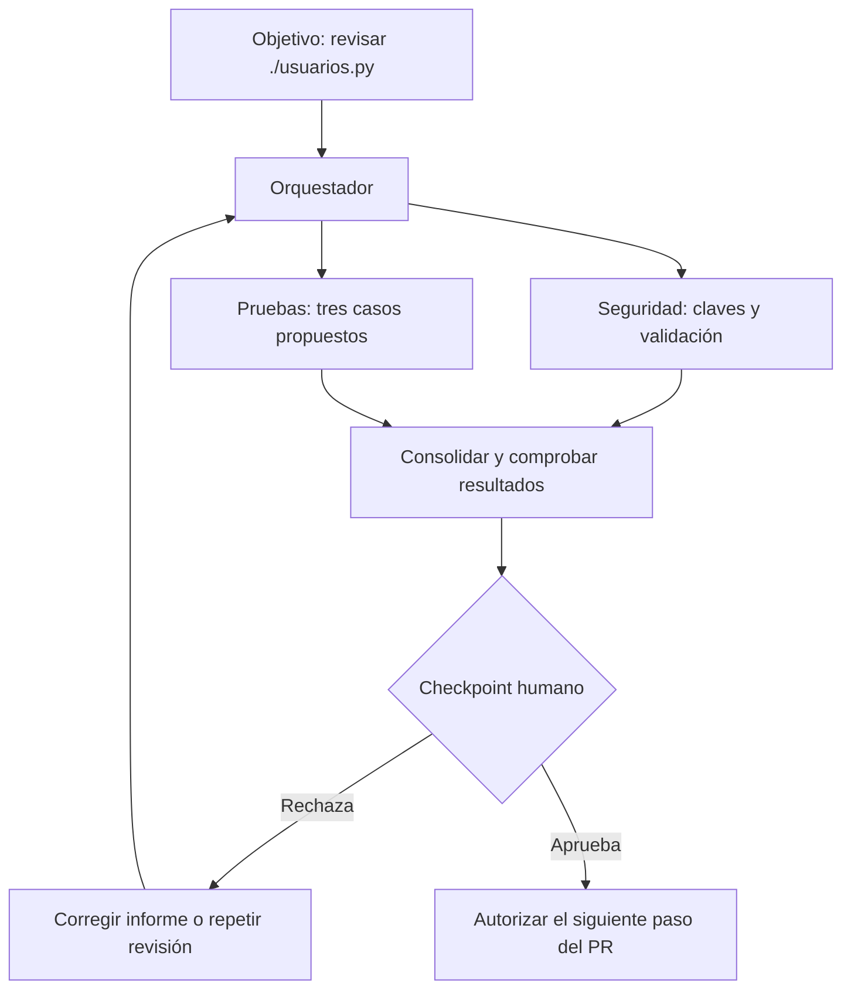
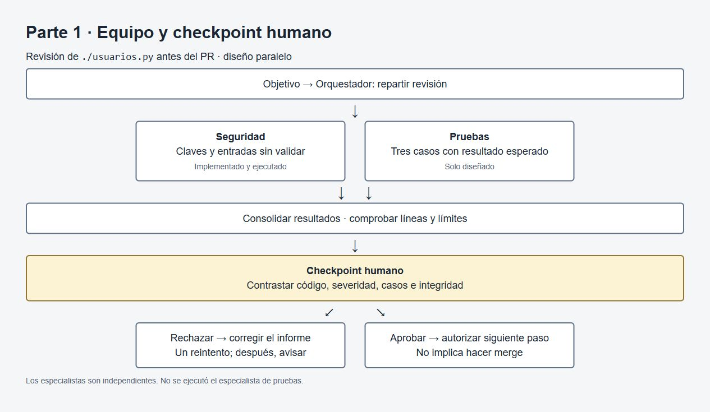
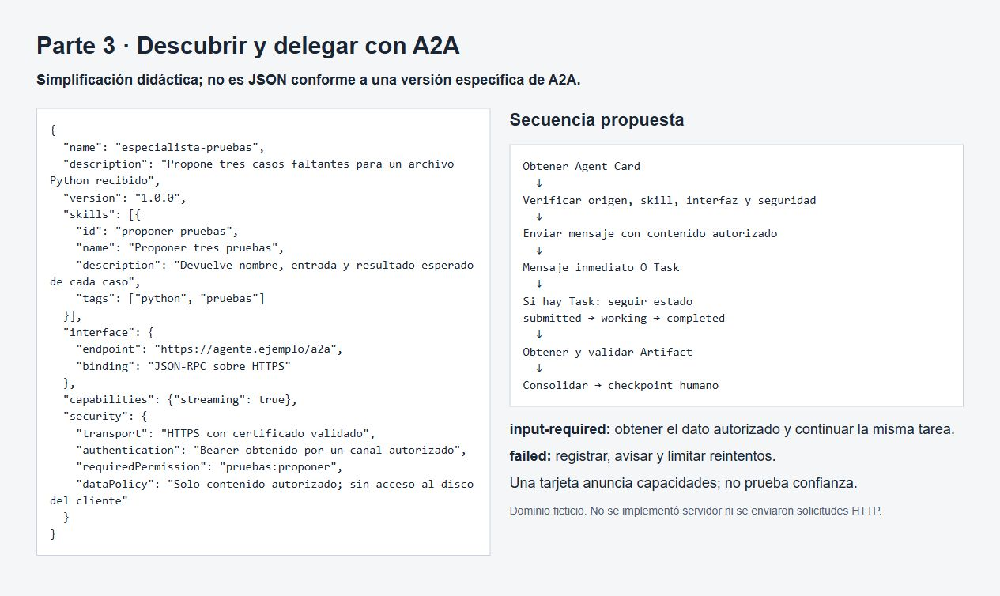

# Deber 6 — Equipo de agentes

## Equipo y tarea

La tarea es revisar `usuarios.py`, en la raíz de este repositorio, antes de abrir un PR. El archivo tiene 42 líneas y se conserva como vino en la plantilla. Uso la ruta relativa para que el equipo funcione al clonar el proyecto en otra computadora.

| Agente | Misión | Herramientas autorizadas | Entrada | Salida | Límites |
|---|---|---|---|---|---|
| Orquestador | Repartir la revisión y consolidar los resultados | Ninguna propia; solo delega | Ruta `./usuarios.py` | Tabla de hallazgos y casos propuestos | No modifica archivos ni aprueba cambios |
| Especialista 1 — Seguridad | Buscar claves o tokens en el código y entradas sin validar | Lectura y búsqueda sobre el archivo indicado | Ruta `./usuarios.py` y contenido con líneas | Lista con línea, problema, severidad y evidencia | Solo ese archivo; no escribe, ejecuta Python ni consulta servicios |
| Especialista 2 — Pruebas | Proponer tres casos que faltan | Lectura del archivo indicado | Ruta `./usuarios.py` | Nombre de cada caso y qué verifica | Solo propone; no escribe ni ejecuta pruebas |

En la ejecución se implementa únicamente Seguridad. Pruebas queda diseñado, como pide el deber. Los casos de abajo son propuestas del diseño, no resultados de un segundo subagente ejecutado. El adaptador de la herramienta entrega el contenido al especialista; el rol conceptual del orquestador sigue siendo coordinar.

## Flujo y checkpoint humano

Elijo un flujo paralelo porque Seguridad y Pruebas pueden revisar el mismo archivo sin esperar la salida del otro. El orquestador espera los dos resultados antes de consolidar. Este es el diseño completo; en esta entrega solo se ejecutó la rama de Seguridad.



La persona compara cada línea con el código, revisa la severidad y comprueba que los casos tengan entradas y resultados claros. También revisa que no se hayan cambiado archivos ni copiado secretos reales. Rechazaría un hallazgo que invente una línea, que llame vulnerable al INSERT parametrizado de la línea 34 o que confunda una prueba propuesta con una prueba aprobada. Aprobar este informe no significa autorizar automáticamente un merge, un despliegue o una modificación de `usuarios.py`.

## Fallos y recuperación

Una salida vacía sin explicación, líneas fuera de 1–42 o cambios de archivo indican un fallo. Una respuesta explícita de «sin hallazgos» también se compara con el código: no basta con que tenga el formato correcto. Para Pruebas se comprueba además que haya exactamente tres casos y un resultado esperado para cada uno.

El orquestador marca la revisión incompleta, devuelve el problema concreto al especialista y permite un reintento. Si vuelve a fallar, avisa a la persona y conserva el error; no completa la tabla inventando resultados. Si se viola un límite, detiene ese flujo y pide revisión humana. Un fallo de una rama no se oculta con el éxito de la otra.

## Consolidación

La revisión de seguridad real y su registro están en [respuestas.md](respuestas.md#ejecución-local). Estos hallazgos se comprobaron contra el archivo sin cambiarlo.

| Origen | Línea o función | Hallazgo o caso | Severidad / resultado esperado |
|---|---|---|---|
| Seguridad | 10 | `API_KEY` está escrita en el código; la plantilla aclara que es falsa | Baja en esta plantilla; no prueba una filtración real |
| Seguridad | 11, 42 | `ADMIN_PASSWORD` está escrita en el código y se usa en `es_admin` | Media en esta plantilla de ejemplo |
| Seguridad | 21–22 | `nombre` se concatena a la consulta SQL | Alta: permite alterar la consulta |
| Seguridad | 30–37 | Se guardan nombre, edad y correo sin validación de aplicación | Media: se aceptan datos inválidos; el INSERT sí usa parámetros |
| Seguridad | 25–27 | No se validan tipos ni rangos del precio y del porcentaje | Media: cálculos inválidos o errores de tipo |
| Pruebas, solo diseño | `buscar_usuario` | `test_buscar_usuario_no_interpreta_sql`: usar un nombre con comillas y una condición SQL | El nombre se trata como dato; no devuelve usuarios ajenos. El código actual necesita corrección |
| Pruebas, solo diseño | `crear_usuario` | `test_crear_usuario_rechaza_datos_invalidos`: caso parametrizado con nombre vacío, edad negativa o correo sin formato | Rechazo explícito antes de insertar; la base queda sin cambios. Son reglas propuestas |
| Pruebas, solo diseño | `calcular_descuento` | `test_descuento_valida_limites`: con precio 100, revisar 0%, 100%, −1% y 101% | Devuelve 100 y 0 para los válidos; rechaza los porcentajes fuera de 0–100 |

Las pruebas de base de datos usarían una conexión SQLite en memoria con la tabla `usuarios`, nunca `tienda.db`. No se implementaron ni ejecutaron estas pruebas. Los criterios de validación se proponen para una corrección futura y no se presentan como requisitos que ya aplica el archivo.

## A2A

Ahora imagino que Pruebas pertenece a otro equipo y corre en otro servidor. En vez de lanzar un hilo local, el cliente descubre su interfaz y le delega una tarea por red.

> Simplificación didáctica; no es JSON conforme a una versión específica de A2A.

```json
{
  "name": "especialista-pruebas",
  "description": "Propone tres casos faltantes para un archivo Python recibido",
  "version": "1.0.0",
  "skills": [{
    "id": "proponer-pruebas",
    "name": "Proponer tres pruebas",
    "description": "Devuelve nombre, entrada y resultado esperado de cada caso",
    "tags": ["python", "pruebas"]
  }],
  "interface": {
    "endpoint": "https://agente.ejemplo/a2a",
    "binding": "JSON-RPC sobre HTTPS"
  },
  "capabilities": {"streaming": true},
  "security": {
    "transport": "HTTPS con certificado validado",
    "authentication": "Bearer obtenido por un canal autorizado",
    "requiredPermission": "pruebas:proponer",
    "dataPolicy": "Solo contenido autorizado; sin acceso al disco del cliente"
  }
}
```

Obtendría la tarjeta de `https://agente.ejemplo/.well-known/agent-card.json`, mediante una URL conocida y aprobada. El dominio es ficticio. El cliente comprobaría el origen y certificado, la skill `proponer-pruebas`, una interfaz y versión compatibles, y el mecanismo de autenticación exigido. No seguiría un endpoint de otro origen sin autorizarlo. La tarjeta anuncia capacidades; no ejecuta la tarea ni demuestra que el agente sea confiable. La confianza requiere una evaluación aparte del proveedor y de los datos que se le permite recibir.

### Secuencia

1. Obtener la Agent Card y validar origen, skill, interfaz y seguridad.
2. Preparar el contenido autorizado de `usuarios.py`, con líneas y versión o hash. Una ruta local por sí sola no permite al servidor leer el archivo.
3. Enviar un mensaje que pida exactamente tres casos con nombre, entrada y resultado esperado. El ejemplo no usa credenciales reales ni realiza tráfico HTTP.
4. Si devuelve un mensaje inmediato, validar su contenido y consolidarlo. No siempre se crea una Task.
5. Si devuelve una Task, conservar su identificador. Seguirla por streaming si ambas partes lo admiten, o consultar su estado mediante polling compatible.
6. Al completarse, obtener el Artifact con los tres casos. Validar cantidad, estructura y relación con el archivo antes de mostrarlo a la persona.

### Estados

`submitted → working → completed` significa que recibió la tarea, empezó a trabajar y terminó. `completed` no garantiza que las pruebas propuestas sean buenas: todavía se revisan.

Si llega `input-required` porque falta el esquema de la tabla, el cliente muestra la pregunta y obtiene ese contexto de una fuente autorizada. Lo envía usando el identificador de la tarea y el mecanismo de continuación de la interfaz; no supone que sigue avanzando. Si la Task termina en `failed`, registra el error y avisa. Solo reintenta fallos temporales con un límite y sin duplicar trabajo; un error de autorización no se resuelve insistiendo.

### Diferencia con el subagente local y con MCP

El subagente local vive dentro del harness de la herramienta y recibe el contexto que se le delega. No necesita Agent Card ni endpoint. En A2A aparecen descubrimiento, una interfaz de red compatible, autenticación entre sistemas, latencia y posibles fallos de conexión. El agente remoto no hereda acceso a mi disco ni debe recibir las credenciales de mi sesión. También hay un límite de confianza entre equipos: sus resultados se tratan como entradas externas.

MCP conecta un agente con herramientas y recursos. Por ejemplo, una herramienta MCP podría devolver el contenido autorizado de un archivo. A2A delega trabajo a otro agente que decide cómo resolverlo mediante su interfaz. No elegiría MCP o A2A solo porque se lee un archivo: elegiría según si necesito llamar una herramienta o encargar una revisión autónoma a otro agente. Tampoco cualquier comunicación entre agentes implementa A2A.




